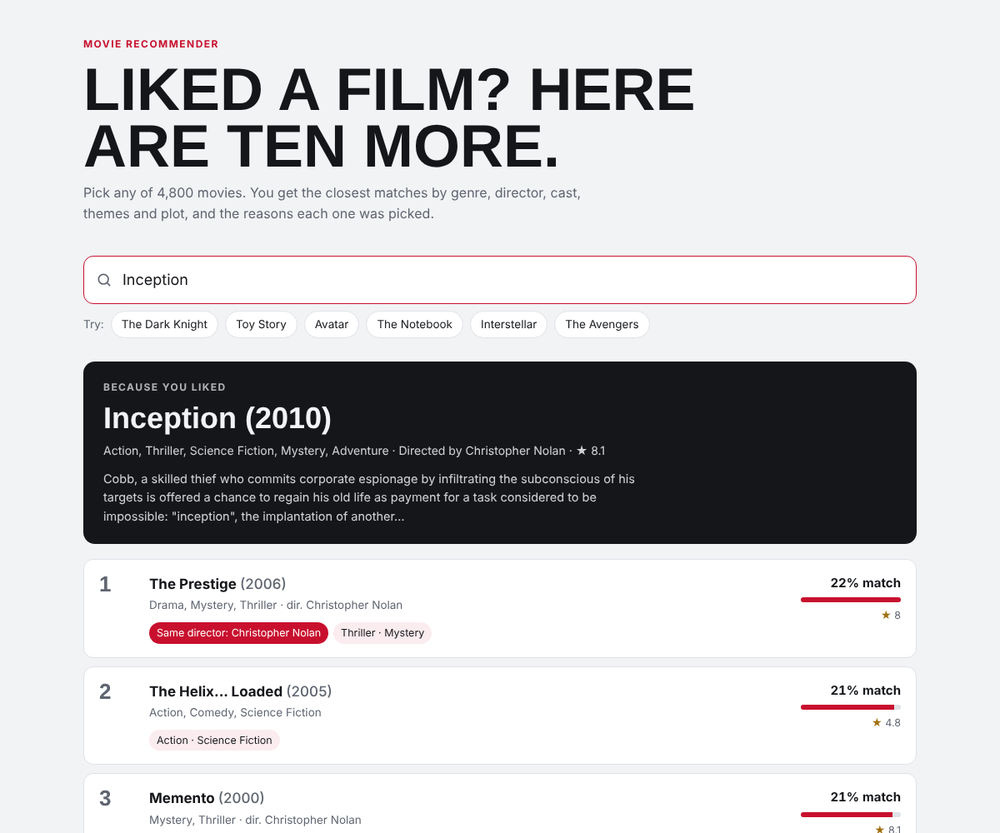

# Movie Recommendation System

Pick a film you like and get the ten closest matches out of 4,800 movies, with the reason each one was picked.

**Live demo:** https://phanisrikanth9.github.io/Movie-Recommendation-System/ (runs in the browser, no server)



## How it works

1. **Data:** the [TMDB 5000 Movie Dataset](https://www.kaggle.com/datasets/tmdb/tmdb-movie-metadata) (movies + credits), joined on the movie id.
2. **Features:** for each film, its genres, keywords, top 3 cast, director and plot overview. Names are glued into single tokens (`Christopher Nolan` → `christophernolan`) so a person counts as one feature.
3. **Weighting:** structured fields are repeated so they count more than plot words (genres ×4, director ×3, cast ×2, keywords ×1, overview ×1). The text is Porter-stemmed and vectorised with TF-IDF (5,000 terms).
4. **Similarity:** cosine similarity between every pair of films.
5. **Re-rank:** a light quality prior, the vote-weighted rating used for IMDb's Top 250, so obscure, badly rated films don't outrank well-known close matches.
6. **Storage:** only each film's 20 nearest neighbours are saved (`artifacts/movies.json`, 3.3 MB) instead of the full 4,800 × 4,800 similarity matrix (185 MB).
7. **Explanations:** every recommendation lists what it shares with your film: director, cast, genres, themes.

## Results

There are no user ratings in this dataset, so quality is measured with two checks over all 4,800 films:

| Version | Top 10 share a genre | Same director in top 10* | Mean rating of top 10 |
|---|---|---|---|
| Original (bag of words, equal weights) | 88.5% | 15.1% | 5.99 |
| TF-IDF + weighted fields | 90.5% | 81.7% | 5.99 |
| + quality re-rank (current) | 90.5% | 81.6% | 6.13 |

\* For films whose director made at least one other film in the dataset.

The field weights were chosen by comparing a few settings on these same checks, so treat the numbers as a sanity check, not a held-out benchmark.

## Run it

```bash
pip install -r requirements.txt
python recommender.py build           # data/ -> artifacts/movies.json (about 20 s)
python recommender.py "The Dark Knight"
streamlit run app.py                  # web app
pytest -q                             # tests
```

### Movie posters (optional)

The Streamlit app shows posters when a TMDB API key is available. Get a free key at [themoviedb.org](https://www.themoviedb.org/settings/api), then put it in `.streamlit/secrets.toml`:

```toml
TMDB_API_KEY = "your-key"
```

or set the `TMDB_API_KEY` environment variable. Never commit the key.

## Files

| Path | What it is |
|---|---|
| `recommender.py` | Loading, feature building, similarity, evaluation, `recommend()` |
| `app.py` | Streamlit app |
| `index.html` | Browser demo used by GitHub Pages |
| `data/` | TMDB movies and credits (gzipped CSV) |
| `artifacts/` | Built neighbour lists and metrics |
| `tests/` | pytest suite |

## Changes from the first version

- Removed a hard-coded TMDB API key from the code
- Movies and credits are joined on id, not title (different films can share a title)
- Hyphenated names (Gordon-Levitt) no longer split into two tokens and get double weight
- 185 MB Git LFS similarity matrix replaced by a 3.3 MB neighbour list
- Two overlapping scripts merged into one module with tests
- Recommendations come with reasons, and there is a live demo

Built by [Phani Srikanth Samayam](https://phanisrikanth9.github.io/Phani-Portfolio/).
